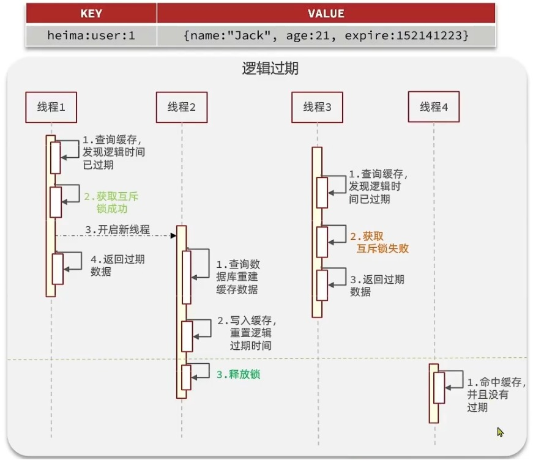

# 基于Redis实现登录
1. 发送邮箱验证码
- 验证码间隔期60s，有效期3min
- 先写入Redis再发送
```text
code = RandomUtil.randomNumbers(6);
stringRedisTemplate.opsForValue().set(codeKey, code, TTL, Unit);
javaMailSender(code);
```
2. 邮箱验证码登录(前端传入LoginDTO)
2.1 校验验证码
- 比较从前端获取的与Redis中存入的
```text
code = loginDTO.getCode();
cacheCode = stringRedisTemplate.getCode();
if(!code.equals(cacheCode)){
    验证码错误！
        }
```
2.2 根据email查询用户
- 如果从数据库中没查到用户则注册，如果查到用户则执行`token = RandomUtil.randomString(32)`
```text
email = loginDTO.getEmail();
user = findbyEmail(email);
if(user == null){
User user = new User();
user.setEmail(email);

userMapper.insert(user);
user = userMapper.findById(user.getById());
}
```
2.3 把用户信息写入Redis
- 需要把user对象转换为HashMap存储
```text
HashMap<String, Object> userMap = BeanUtil.beanToMap(user);
userMap.values().removeIf(value -> value == null);
userMap.replaceAll((key, value) -> value.toString());
stringRedisTemplate.opsForHash().putAll(tokenKey, userMap);
```
2.4 返回token
- token设置有效期
- opsForHash().putAll()与opsForValue().set()不一样，无法直接指定TTL
`stringRedisTemplate.expire(tokenKey, TTL, Unit);`

## token的滚动刷新
- 双拦截器机制（刷新拦截器+登录拦截器）
1. 刷新拦截器拦截一切路径，全部放行
1.1 从请求头获取token
```text
token = request.getHeader("authorization");
```
1.2 根据token查询Redis中的用户
- 判断用户是否存在
- 若无，放行
- 若有，继续执行
```text
if(StrUtil.isBlank(token)){
return true;
}
```
1.3 把用户存入当前线程
- 在Redis中查询用户(查不到也直接放行)
- HashMap-->UserDTO
```text
userMap = stringRedisTemplate.opsForHash().entris(key);
if(userMap.isEmpty()){
return true;
}
userDTO = BeanUtil.fillBeanWithMap(userMap, new UserDTO(), false);
userHolder.save(userDTO);
```
2. 登录拦截器拦截指定路径，部分放行
- 在当前线程中查询用户(若登录则放行，未登录则拦截)
```text
if(userHolder.getUser()){
return false;
}
return true;
```

# 缓存
- 查询缓存是为了解决重复查询给数据库带来压力<br>

1. 缓存更新（内存有限）
- 常见的3种方法：内存淘汰、超时剔除、主动更新
1.1 数据库与缓存的一致性
- Cache Aside（由业务代码负责维护数据库和缓存）
- 查询：
```text
先查缓存-->命中就返回
       -->未命中再查数据库-->回填缓存-->返回
```
- 修改：先更新数据库-->再删除对应缓存（TTL兜底，删除失败或旧值被重新写入后，避免长期存在）
1.2 缓存穿透（持续查询不存在的数据）
- 缓存空对象、布隆过滤器
- 以查询充电站为例（前端传入id）
```text
key = RedisKeyConstant.station(id);
stationJson = stringRedisTemplate.opsForValue().get(key);
if(StrUtil.isNotBlank(stationJson)){
station = JsonUtil.toBean(stationJson, Station.class);
return station;
}
if(stationJson != null){
stringRedisTemplate.opsForValue().set(key, "");
throw new BusinessException(404, "充电站不存在！");
}
station = stationMapper.findById(id);
if(station == null){
stringRedisTemplate.opsForValue().set(key, "", TTL, TimeUnit);
throw new BusinessException(404, "充电站不存在！");
}
stringRedisTemplate.opsForValue().set(key, JsonUtil.toJsonStr(station), TTL, TimeUnit);
return station;
```
1.3 缓存雪崩（缓存中的大量key同时失效或缓存服务宕机）
- 给不同的key（包括空值）添加TTL随机值
```text
ThreadLocalRandom.current().nextLong(...);
```
- Redis集群（哨兵）
- 访问限流
- 为业务添加多级缓存
1.4 缓存击穿（缓存中的热点key失效） 
- 互斥锁<br>

```text
查询缓存
  ├─ 命中 → 返回结果
  └─ 未命中 → 尝试获取互斥锁
                ├─ 失败 → 等待一段时间重试
                └─ 成功 → 再查一次缓存
                            ├─ 命中 → 返回结果
                            └─ 未命中 → 查数据库 → 写入缓存
                         最后在 finally 中释放锁
```
```text
RLock lock = redissonClient.getLock(key1);
boolean acquiredFlag = lock.trylock(tryTTL, TimeUnit);
if(!acquiredFlag){
throw new Exception;
}
String stationJson = stringRedisTemplate.opsForVale().get(key2);
if(StrUtil.isNotBlank(stationJson)){
return JSONUtil.toBean(stationJson, Station.class);
}
if(stationJson != null){
stationJson = stringRedisTemplate.opsForVale().get(key2);
return JSONUtil.toJsonStr(stationJson);
}
Station station = stationMapper.findById(id);
if(station == null){
stringRedisTemplate.opsForVale().set(key2, "", TTL, TimeUnit);
throw new Exception;
}
stringRedisTemplate.opsForValue().set(key2, JSONUtil.toJsonStr(station), TTL, TimeUnit);
return station;

lock.unlock();
```
- 逻辑过期<br>

- Station实体类并没有逻辑过期时间，这里选择新建含逻辑过期时间的实体类RedisData
- setWithLogicalExpire(String key, Object value, Long time, TimeUnit unit)负责将逻辑过期时间写入缓存
```text
RedisDta redisData = new RedisData();
redisData.setData(value);
redisData.setExpireTime(LocalDataTime.now().plusSeconds(unit.toSeconds(time)));
stringRedisTemplate.opsForValue().set(key, JSONUtil.toJsonStr(redisData));
```
1.4.1 先查缓存（默认进行预热处理），查不到直接`return null;`，判断逻辑过期时间
```text
String redisDataJson = stringRedisTemplate.opsForValue().get(stationKey);
if(StrUtil.isBlank(redisDataJson)){
//未命中则直接结束
return null;
}
```
- 判断是否过期（首先要解析缓存数据）
```text
RedisData redisData = JSONUtil.toBean(redisDataJson, RedisData.class);
if(redisData.getExpireTime().isAfter(LocalDateTime.now())){
return JSONUtil.toBean(JSONUtil.toJsonStr(redisData.getData()), Station.class);
}
```
- 过期&抢锁成功，开启独立线程`CACHE_REBUILD_EXECUTOR.submit(()->{});`以实现缓存重建
- 注意：因为Redisson中的RLock要求抢锁与解锁必须在一个线程里面，所以把抢锁也写进异步线程！！！
```text
{
RLock lock = redissonClient.getLock(lockKey);
if(!lock.tryLock()){
//抢锁失败则直接退出该进程
 return;
 }
//抢锁成功后还要再查缓存，判断是否过期
RedisData latestJson = stringRedisTemplate.opsForValue().get(stationKey);
if(latestJson.getExpireTime().isAfter(LocalDateTime.now())){
//未过期则结束当前进程，直接返回
return;
}
Station newStation = stationMapper.findById(id);
setWithLogicalExpire(stationKey, newStation, time, TimeUnit);
}
return station;
```

# 优惠券


